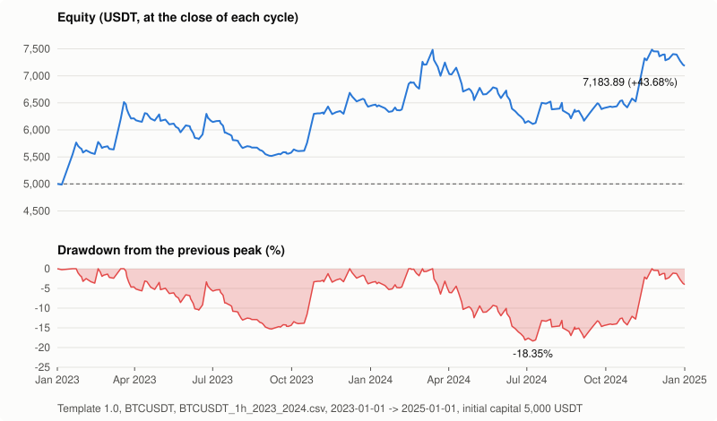

# SXE Core - Strategy eXecution Engine

Motore C++17 che esegue strategie di trading caricate come librerie esterne, con un
simulatore realistico dei futures perpetui con margine in USDT.

La strategia è compilata come libreria separata (`.so`) e non sa da dove arrivano i prezzi.
Il motore la carica all'avvio, ne controlla l'interfaccia, le passa i dati del mercato passo
dopo passo ed esegue i suoi ordini su un exchange simulato che riproduce le regole di uno
vero: ordini a mercato e limite, commissioni taker e maker, slippage, margine
isolated/crossed, margine di mantenimento a scaglioni, funding ogni 8 ore e liquidazione.

Versione 1.1.0 - modifiche in [CHANGELOG.md](CHANGELOG.md) (in inglese)  
English version: [README.md](README.md)


## Punti di forza

### Strategie come plugin
Si scrive una classe, si aggiunge una macro, si compila una `.so`. Il motore rifiuta le
librerie che non sono strategie o che sono state compilate con un'altra versione
dell'interfaccia. Le strategie si possono compilare anche fuori dal progetto con una sola
funzione CMake.

### Motore deterministico a thread unico
Un passo = dati -> funding -> exchange -> `Run()` della strategia.
Stessi dati, stesso risultato al centesimo: verificato dai test golden.

### Simulazione realistica dei futures
Sul modello di Bitget BTCUSDT perpetuo, tutto configurabile.

- ordini a mercato con commissione taker e slippage; ordini limite (acquisto, chiusura) con
  commissione maker e senza slippage, eseguiti al loro prezzo quando il mercato li supera di
  un tick (o appena li tocca), con il margine degli acquisti aperti prenotato
- passo della quantità, quantità minima, valore minimo dell'ordine
- margine isolated o crossed
- margine di mantenimento a scaglioni progressivi (ogni fascia della posizione paga il tasso
  del suo scaglione) e calcolo del prezzo di liquidazione scaglione per scaglione
- funding ogni 8 ore da un file storico, con un tasso di riserva e un moltiplicatore per le
  prove di stress
- liquidazione: in isolated si perde il margine della posizione e si continua, in crossed si
  perde il conto e la simulazione si ferma

### Percorso del prezzo dentro la candela
Ogni candela viene percorsa come una sequenza di tick (solo chiusura, secondo la direzione,
prima il minimo o prima il massimo) con tick intermedi facoltativi: ordini e liquidazioni
avvengono dentro la candela. La strategia vede solo candele chiuse: niente prezzi futuri.

### Archivio dei cicli
Un ciclo va dal primo acquisto alla chiusura completa. Alla chiusura il motore crea
`Backup/b<N>` con il riepilogo `result.txt`, ci sposta tutti i file di log del ciclo e
aggiunge una riga a `total_result.txt`.

### Ripresa
Si ferma una simulazione con Ctrl+C e la si riprende dopo: il risultato è identico a una
corsa senza interruzioni.

### Cartella dei dati e periodo configurabili
I dati storici possono stare in qualsiasi cartella (`[PATH] data`). Il periodo da simulare
si indica per mese (2023-01 -> 2025-10) o per giorno, con un avviso se i dati non lo coprono.

### Configurazione rigorosa
Ogni chiave viene controllata all'avvio e gli errori vengono segnalati tutti insieme.

### Veloce
Circa 700.000 passi al secondo su un Raspberry Pi 4: due anni di candele da 1 ora con i tick
dentro la candela girano in 0,2 secondi.

### Testato
19 test CTest su dati di mercato reali fissi (BTCUSDT 2023-2024) e su candele costruite a
mano, eseguiti da GitHub Actions a ogni push (Linux arm64, GCC 14).


## Come funziona

```
    file candele + funding
              |
              v
       +-------------+       +---------------------------------------+
       |  Data feed  | ----> |  Motore (thread unico), a ogni passo: |
       |  tick dentro|       |    1. prossimo tick                   |
       |  la candela |       |    2. funding ogni 8 ore              |
       +-------------+       |    3. exchange: equity, liquidazione  |
                             |    4. strategia.Run(ctx)              |
                             |    5. archivio cicli chiusi, stato    |
                             +---------------------------------------+
                                  |              |              |
                                  v              v              v
                         +--------------+  +-----------+  +---------------+
                         |  Exchange    |  | Strategia |  |  Target/Log   |
                         |  simulato    |  | plugin    |  |  Target/Backup|
                         |  commissioni,|  | libX.so   |  |               |
                         |  margine,    |  |           |  |               |
                         |  scaglioni   |  |           |  |               |
                         +--------------+  +-----------+  +---------------+
```

La strategia implementa cinque metodi, chiamati in quest'ordine:

| Metodo | Quando | Cosa fa |
|---|---|---|
| `GetInfo()` | una volta | nome, versione, descrizione |
| `LoadConfig(percorso)` | una volta | legge il suo `.ini` |
| `Init(InitContext)` | una volta | conto e posizione iniziali, regole dell'exchange, cartelle di log e backup |
| `Run(StepContext&)` | ogni passo | decide, piazza gli ordini con `ctx.orders`, ritorna |
| `Term()` | una volta | salvataggi finali e riepilogo |

`Run()` esegue un passo e ritorna: il ciclo è del motore. La strategia non legge l'orologio,
non usa la rete e non parla direttamente con l'exchange. Tempo, prezzi, conto e posizione
arrivano nel contesto; gli ordini passano da `ctx.orders`, in modo sincrono:

| Ordine | Significato |
|---|---|
| `MarketBuy(usdt, leva)` | acquisto a mercato (commissione taker, slippage) |
| `Close()` | chiude tutta la posizione a mercato |
| `LimitBuy(prezzo, usdt, leva)` | acquisto limite sotto il mercato (commissione maker) |
| `LimitClose(prezzo)` | chiusura limite di tutta la posizione sopra il mercato |
| `Move(id, prezzo)`, `Cancel(id)`, `CancelAll()` | modifica o cancella gli ordini limite aperti |

Ogni esito dice il tipo di ordine (mercato o limite), il tasso di commissione e l'id
dell'ordine. Gli ordini limite aperti sono in `ctx.vOpenOrders`, quelli eseguiti dal passo
precedente in `ctx.vFills`. Alla liquidazione l'exchange cancella tutti gli ordini aperti.


## Avvio rapido

Requisiti: Linux, CMake 3.16 o successivo, un compilatore C++17
(provato con GCC 14 su Raspberry Pi OS 64 bit).

```sh
./comp_All.sh test        # compila, installa in Target/ e lancia i test
Target/Bin/SXE            # esegue la strategia di esempio sui dati inclusi nel repository
```

`Target/Bin/SXE percorso/altro.ini` usa un'altra configurazione. Una riga di stato mostra
data, avanzamento, prezzo ed equity. Alla fine il motore stampa un riepilogo (rendimento,
drawdown massimo, cicli, liquidazioni, commissioni, funding, passi al secondo) e lascia una
cartella `Target/Backup/b<N>` per ciclo.

Opzioni di compilazione:

```sh
./comp_All.sh             # build Release
./comp_All.sh debug       # build Debug
./comp_All.sh test        # build Release + test
./comp_All.sh clean       # cancella la cartella di lavoro di CMake CMakeWork/
```


## Esempio di risultato

La strategia di esempio (Template, incrocio delle medie mobili 20/50) sui dati inclusi nel
repository: BTCUSDT 1h, 2023-2024, capitale iniziale 5000 USDT, margine isolato.
`Target/Bin/SXE` stampa:

```text
Simulation finished (end of data) at 2025-01-01 00:00: equity 7183.89 USDT (+43.68% on the
initial capital), drawdown max -19.42%, closed cycles 219 (in profit 81), liquidations 0,
orders 439, rejected 0, fees 832.42 USDT, funding 795.75 USDT, last cycle still open
(archived); 136901 steps in 0.2 s (781833 steps/s)
```

Equity e drawdown alla chiusura di ogni ciclo, da `Target/Backup/total_result.txt`
(il -19.42% qui sopra conta anche le posizioni aperte, tick per tick):



Il grafico è disegnato da `python3 docs/equity_chart.py Target/Backup/total_result.txt out.svg`
(solo libreria standard), anche per le proprie simulazioni.

Il Template mostra come si scrive una strategia; non è una strategia con cui fare trading.


## Usare i propri dati

In `Target/Config/EngineConfig.ini`:

```ini
[PATH]
data = /percorso/dei/tuoi/MarketData     ; cartella dei dati storici

[SIMULATION]
data_file    = BTCUSDT_1h.csv            ; nella cartella dei dati (o percorso assoluto)
funding_file = BTCUSDT_funding.csv       ; nella cartella dei dati, vuoto = funding_rate fisso
start_date   = 2023-01
end_date     = 2025-10
```

I percorsi relativi di `EngineConfig.ini` partono da `Target/Bin`, quindi il motore funziona
da qualunque cartella venga lanciato.

Formato dei file:

```
candele   date;time(UTC);open;high;low;close;volume
          2023-01-01;00:00;16541.77;16545.7;16508.39;16529.67;4364.8357

funding   timestamp,funding_rate
          2023-01-01 00:00,0.00010000
```


## Scrivere una strategia

1. Copiare `file/Strategies/Template` (incrocio di medie mobili) in una nuova cartella e
   rinominare la classe e `NAME` nel suo `CMakeLists.txt`. Copiare
   `Target/Config/Template.ini` come configurazione della nuova strategia.

2. Implementare i metodi di `CStrategyBase` (`file/SDK/StrategyBase.h`).

3. Lasciare la macro di esportazione in fondo al `.cpp`:

   ```cpp
   SXE_EXPORT_STRATEGY(CMiaStrategia)
   ```

4. Ogni cartella di `file/Strategies` con un `CMakeLists.txt` viene compilata da sola.
   Oppure la si compila in un progetto separato, con SXE Core già installato:

   ```cmake
   cmake_minimum_required(VERSION 3.16)
   project(MieStrategie CXX)
   include(<cartella di SXE>/cmake/SXEStrategy.cmake)
   sxe_add_strategy(NAME Mia SOURCES CMiaStrategia.cpp CONFIG Mia.ini)
   ```

   Questo installa `libMia.so` in `Target/Bin/Strategies` e `Mia.ini` in `Target/Config`.

5. Selezionarla in `EngineConfig.ini`:

   ```ini
   [STRATEGY]
   library = libMia.so
   config  = ../Config/Mia.ini
   ```

I file che la strategia scrive in `InitContext::strLogDir` vengono archiviati con il ciclo
automaticamente.

Una strategia che salva un suo stato (per esempio accanto al suo `.ini`) lo ricarica solo se
`InitContext::bResume` è true, cioè quando il motore riprende una simulazione salvata. Se
è false la corsa parte da capo e lo stato lasciato da una corsa precedente va ignorato.


## Configurazione

`Target/Config/EngineConfig.ini`, ogni chiave è commentata nel file:

| Sezione | Contenuto |
|---|---|
| `[ENGINE]` | modalità (SIM), simbolo |
| `[STRATEGY]` | libreria della strategia e suo file di configurazione |
| `[PATH]` | cartelle Log, Backup e dati storici |
| `[EXCHANGE]` | modalità di margine, commissioni taker e maker, slippage, scaglioni del margine di mantenimento, passo della quantità, valore minimo dell'ordine |
| `[SIMULATION]` | periodo, capitale iniziale, file dei prezzi e del funding, funding di riserva e moltiplicatore, percorso dentro la candela, quando si esegue un ordine limite, liquidazione sì/no, ripresa, file di stato e degli ordini |
| `[LOG]` | messaggi info / warning / error / riga sul terminale |


## Risultati

| Percorso | Contenuto |
|---|---|
| `Target/Log/` | file del ciclo in corso: `log.txt`, `error.txt`, registro degli ordini (tipo, prezzo, commissione e tasso di ogni ordine), file della strategia, stato della simulazione |
| `Target/Backup/b<N>/` | una cartella per ciclo chiuso: `result.txt` (apertura/chiusura, prezzi, crescita, drawdown, leva massima, commissioni, funding) più i file spostati da Log |
| `Target/Backup/total_result.txt` | una riga per ciclo, pronta per un foglio di calcolo |


## Test

`./comp_All.sh test` lancia 19 test su dati reali fissi (`file/Tests/Data`: BTCUSDT 1h e
funding, 2023-2024) e su poche candele costruite a mano:

| Test | Verifica |
|---|---|
| `loader_not_strategy` | il motore rifiuta una libreria che non è una strategia, |
| `loader_old_api` | compilata con un'altra versione dell'interfaccia, |
| `loader_missing` | o assente |
| `config_example` | l'`EngineConfig.ini` di esempio è valido |
| `golden_template` | la strategia Template dà esattamente il risultato di riferimento |
| `golden_isolated` | ordini dentro la candela, funding, liquidazione (margine isolated) |
| `golden_crossed` | lo stesso con margine crossed |
| `golden_low_first` | percorso estremo dentro la candela: prima il minimo |
| `golden_high_first` | percorso estremo dentro la candela: prima il massimo |
| `golden_bitget` | parametri reali dell'exchange: margine a scaglioni, slippage basso, moltiplicatore del funding |
| `golden_limit` | acquisto limite e chiusura limite, la chiusura spostata quando cambia il prezzo medio |
| `no_liquidation_warning` | con `liquidation = 0` il motore avvisa quando l'equity va sotto zero: il risultato non è realistico |
| `resume` | una corsa fermata a metà candela e ripresa dà gli stessi cicli di una senza interruzioni |
| `resume_limit` | lo stesso con ordini limite aperti |
| `limit_through` | candele costruite a mano: un limite solo toccato non viene eseguito, uno superato di un tick sì al suo prezzo con la commissione maker |
| `limit_touch` | lo stesso con `limit_fill = touch`: eseguito appena toccato |
| `multirun_golden_template` | più motori nello stesso processo: una corsa completa, una che non scrive file e 4 in parallelo danno gli stessi numeri |
| `multirun_golden_isolated` | lo stesso con le liquidazioni |
| `benchmark` | passi al secondo (solo misura) |

I test golden confrontano ogni ciclo con i riferimenti in `file/Tests/Golden`: qualsiasi
modifica al simulatore che cambia anche un solo ciclo li fa fallire. Dopo una modifica
voluta i riferimenti si rigenerano (e vanno ricontrollati) con:

```sh
SXE_UPDATE_GOLDEN=1 ctest --test-dir CMakeWork -R golden
```


## Struttura del progetto

| Cartella | Contenuto |
|---|---|
| `file/` | tutti i sorgenti, una cartella per componente (vedi [file/README.md](file/README.md)) |
| `file/Engine` | ciclo del motore, caricamento della strategia, archivio dei cicli, stato |
| `file/Exchange` | interfaccia dell'exchange ed exchange simulato |
| `file/DataFeed` | interfaccia dei dati e lettore CSV con i tick nella candela |
| `file/SDK` | gli unici header che servono a una strategia |
| `file/Settings` | configurazione e lettore INI |
| `file/Common` | logger, thread, date, tipi comuni |
| `file/Strategies/Template` | strategia di esempio |
| `file/Tests` | test, dati fissi, riferimenti golden |
| `cmake/` | `sxe_add_strategy`, anche per strategie fuori dal progetto |
| `docs/` | grafico di esempio e `equity_chart.py`, che lo disegna da `total_result.txt` |
| `Target/Config` | configurazione di esempio: `EngineConfig.ini`, `Template.ini` |
| `Target/Bin`, `Log`, `Backup` | create dalla compilazione e dalle esecuzioni (non sono nel repository) |


## Limiti della versione pubblica

- Solo simulazione: `mode = REAL` è riservato al trading reale, che non fa parte di questa
  versione.
- Posizioni long con ordini a mercato e limite (apertura/aumento, chiusura completa), un
  simbolo per avvio.
- Solo Linux (le strategie vengono caricate con `dlopen`).


## Versione pubblica e versione privata

Questo repository è la versione pubblica di SXE Core, ferma alla versione descritta qui.
Le funzionalità del motore sviluppate dopo fanno parte della versione privata dell'autore e
sono elencate qui sotto. Per informazioni sulla versione privata vedi [Contatti](#contatti).

### Tuning dei parametri - disponibile
SXE_Tune, programma separato: fa girare in parallelo tante simulazioni della stessa
strategia con parametri diversi e le mette in classifica. SXE resta autonomo. Ricerca a
griglia, casuale e a zoom (prima larga, poi stretta sui migliori); regole tra i parametri
scritte come formule con un nome in `Optimize.ini`, con un riepilogo da controllare prima di
partire; vincoli, classifica e il `.ini` migliore pronto per SXE. I migliori vengono poi
controllati su periodi non usati per il tuning e con i valori vicini dei parametri: la
scelta robusta è quella col caso peggiore più alto.

### Interfaccia grafica - prevista
Configurazione, simulazione con grafici (prezzo, ordini, equity, drawdown, cicli) e tuning
dei parametri da una finestra. Programma separato: SXE continua a funzionare da solo anche
senza.


## Contatti

Francesco Tinelli - [LinkedIn](https://www.linkedin.com/in/francesco-tinelli)

Scrivimi per domande su SXE Core, per il permesso di usarlo a fini commerciali
(vedi [Licenza](#licenza)) o per informazioni sulla versione privata.
Le segnalazioni di bug sono benvenute come issue su GitHub.


## Licenza

Copyright (c) 2026 Francesco Tinelli

SXE Core è distribuito con la licenza PolyForm Noncommercial 1.0.0 (vedi [LICENSE](LICENSE)):
si può studiare, usare e modificare liberamente per qualsiasi scopo non commerciale; l'uso
commerciale richiede il permesso dell'autore.

Il parser INI è [inih](https://github.com/benhoyt/inih) di Ben Hoyt, licenza BSD-3-Clause,
vedi `file/Settings/LICENSE_inih.txt`.


## Avvertenza

Questo software è uno strumento di simulazione e ricerca. Non è una consulenza
finanziaria. I risultati passati, simulati o reali, non garantiscono quelli futuri. Il
trading di derivati con leva può far perdere più del capitale iniziale.
