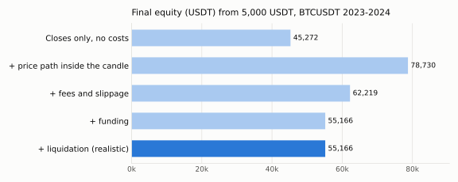
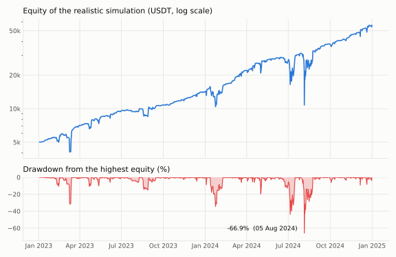
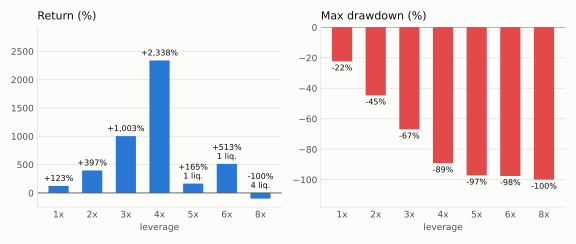

# What a backtest hides: a leveraged DCA bot under realistic simulation

A case study run with SXE Core on two years of BTCUSDT data (2023-2024). The strategy is
the textbook "DCA bot" that many trading platforms and exchanges offer as a ready-made
product: a first buy, more buys every few percent lower, one take profit on the average
price. The question is not whether it makes money, but how much of what a backtest shows
survives a realistic simulation, and what the headline number hides.

Every number and chart on this page comes from [`case_study.py`](case_study.py), from the
data in this repository: anyone can run it again (see [Reproduce](#reproduce)).

## Summary

- **380 cycles closed, 380 in profit, +1003% in two years.** On 5 August 2024 the same
  account was **66.9% below its peak**: BTC fell 25% in less than four days with every buy of the
  cycle already filled. That cycle closed in profit too, +4.2%.
- **The details of the simulation move the result both ways.** A backtest on candle closes
  gives +805%; the price path inside the candle raises it to +1475%; fees, slippage and
  funding take it back to +1003%. With the same data, the unknown order of low and high
  inside the 1-hour candles alone gives anything between +997% and +1327%.
- **Leverage has a cliff.** 4x: +2338%. 5x: one liquidation, in August 2024, and +165%.
  8x: the account is gone.
- **The return depends on the parameters, the risk does not.** Nine neighbouring settings
  give from +302% to +1593%, and all of them a drawdown between 58% and 73%.

## The strategy

[`SimpleDca`](../file/Strategies/SimpleDca/CSimpleDcaStrategy.cpp) is long only, one
position at a time:

1. at the close of a candle with no position, it buys the base order;
2. every time the price falls another `step_perc` below that first entry, it buys a safety
   order, each one `size_mult` times the previous one: the average price goes down;
3. when the price is `take_profit_perc` above the average price, it closes everything. The
   next cycle starts at the next candle close.

The parameters ([`SimpleDca.ini`](../Target/Config/SimpleDca.ini)) are common textbook
values. They were fixed before the first run and never changed after looking at the
results:

| Parameter | Value | Meaning |
|---|---|---|
| `budget_perc` | 95 | % of the available balance a whole cycle may use as margin |
| `safety_orders` | 4 | buys below the first entry, at -3%, -6%, -9%, -12% |
| `step_perc` | 3 | distance between the levels, % of the first entry |
| `size_mult` | 1.5 | each safety order is 1.5 times the previous one |
| `take_profit_perc` | 1.5 | close at +1.5% over the average price |
| `leverage` | 3 | leverage of every order |

## Data and simulation

- BTCUSDT perpetual futures, 1-hour candles from 1 January 2023 to 31 December 2024: BTC
  went from 16,542 to 93,576 USDT. Historical funding, paid every 8 hours.
- 5,000 USDT of initial capital, isolated margin.
- Bitget contract rules: 0.06% taker fee, 0.005% slippage, maintenance margin tiers,
  liquidation when the margin is no longer enough.
- The price moves inside every candle (open, low, high, close for a rising candle; open,
  high, low, close for a falling one) with a tick every 0.2%, and the strategy sees every
  tick: orders and take profits can happen inside the candle, as on the exchange.

## 1. From the naive backtest to the realistic one

The same strategy and data, adding one ingredient of the simulation at a time:



| Simulation | Return | Max drawdown | Final equity | Cycles | Fees | Funding |
|---|---|---|---|---|---|---|
| Closes only, no costs | +805.4% | -61.1% | 45,272 | 214 | 0 | 0 |
| + price path inside the candle | +1474.6% | -66.5% | 78,730 | 379 | 0 | 0 |
| + fees and slippage | +1144.4% | -66.7% | 62,219 | 380 | 4,834 | 0 |
| + funding | +1003.3% | -66.9% | 55,166 | 380 | 4,446 | 2,509 |
| + liquidation (realistic) | +1003.3% | -66.9% | 55,166 | 380 | 4,446 | 2,509 |
| Realistic, low first in every candle | +1326.6% | -66.9% | 71,330 | 434 | 5,812 | 2,572 |
| Realistic, high first in every candle | +996.9% | -66.9% | 54,844 | 382 | 4,416 | 2,491 |

- **Candle closes underestimate this strategy.** A DCA buys dips and takes small profits:
  many of them happen inside an hour and leave no trace in the closes. Seen on closes only,
  the strategy runs 214 cycles instead of 379.
- **Costs compound.** 4,834 USDT of fees and slippage cost 16,511 USDT of final equity,
  because every fee is also money that no longer grows. Funding takes another 7,053.
  Together they remove 30% of the final equity.
- **The path inside the candle is unknown, and it matters.** With 1-hour candles nobody
  knows whether the low or the high came first. Low first is good for this strategy (buy,
  then take profit in the same candle), high first is not: +1327% or +997% from the same
  data.
- No liquidation at 3x, so the last step changes nothing here; section 3 shows when it
  does.

The direction of the error is not known in advance: here a simple backtest is too
pessimistic on the trades and too optimistic on the costs. The only way to know is to
simulate everything.

## 2. The price of +1003%



On 29 July 2024 cycle 298 opened at 69,803 with 31,616 USDT of capital. By 5 August BTC
was at 49,000, 30% below the entry: all four safety orders were filled, the position was
worth 2.85 times the capital at the start of the cycle, and the account was at 10,476 USDT, **66.9% below its peak**. Then
the price came back, and on 23 August the cycle closed with **+4.2%**.

In the list of cycles it is a winning trade, like all the other 379. The list of cycles
of a DCA bot shows how often it wins; only the equity during each cycle shows what it
risks. 4 cycles had a drawdown worse than 30%.

For comparison, holding BTC without leverage gained +466% in the same two years. The same
DCA without leverage gains +123%: most of the time only the base order, 1/13 of the
budget, is in the market. The higher return comes from leverage, and so does the risk.

## 3. Leverage



| Leverage | Return | Max drawdown | Liquidations |
|---|---|---|---|
| 1x | +123.1% | -22.3% | 0 |
| 2x | +397.3% | -44.6% | 0 |
| 3x | +1003.3% | -66.9% | 0 |
| 4x | +2338.5% | -89.2% | 0 |
| 5x | +165.1% | -97.2% | 1 |
| 6x | +512.8% | -97.6% | 1 |
| 8x | -99.9% | -99.9% | 4 |

Up to 4x, more leverage means more return. At 5x the same cycle 298 of August 2024 is
liquidated: the account goes from 106,702 to 5,029 USDT in one week and the two years
end at +165%. At 8x the first liquidation comes in March 2023, and the fourth one, in
August 2024, leaves less than 6 USDT. The best leverage of the past is one step away from the
cliff, and the step is only visible after the fact.

## 4. Robustness

Every 12-month window, same parameters:

| Window | Return | Max drawdown |
|---|---|---|
| 2023-01 to 2023-12 | +181.9% | -40.9% |
| 2023-02 to 2024-01 | +147.7% | -40.9% |
| 2023-03 to 2024-02 | +201.0% | -39.1% |
| 2023-04 to 2024-03 | +212.5% | -39.1% |
| 2023-05 to 2024-04 | +203.7% | -39.1% |
| 2023-06 to 2024-05 | +217.5% | -39.1% |
| 2023-07 to 2024-06 | +189.6% | -39.1% |
| 2023-08 to 2024-07 | +208.3% | -46.4% |
| 2023-09 to 2024-08 | +221.7% | -66.9% |
| 2023-10 to 2024-09 | +249.3% | -66.9% |
| 2023-11 to 2024-10 | +257.7% | -66.9% |
| 2023-12 to 2024-11 | +279.3% | -66.9% |
| 2024-01 to 2024-12 | +288.1% | -66.9% |

Neighbouring parameters, two years (return / max drawdown):

| `step_perc` \ `take_profit_perc` | 1% | 1.5% | 2% |
|---|---|---|---|
| 2% | +861.7% / -72.7% | +1206.6% / -72.7% | +1592.7% / -72.3% |
| 3% | +584.3% / -66.3% | **+1003.3% / -66.9%** | +1092.9% / -66.3% |
| 4% | +302.1% / -59.7% | +460.3% / -57.8% | +546.6% / -58.2% |

Every window is positive, and every window that contains August 2024 has the same -67%
drawdown. The parameters change the return by a factor of five, the drawdown much less:
it comes from the budget and the leverage, which are the same in all of them. Tuning the
levels can make the return look better; it does not make the risk go away.

## Limits

- **Two years of a rising market.** BTC went up more than five times. A long-only DCA in a
  falling year such as 2022 would look very different, and these data cannot show it.
- One symbol, one exchange's rules, 1-hour candles. The path inside the candle is a model
  (section 1 shows how much it can move the result).
- Fixed slippage, no order book: large orders would cost more.
- The parameters were not optimised, which is the point: an optimised set would look better
  on these data and say even less about the next two years.

This is a study of a simulation, not a recommendation to trade this strategy or any other.

## Reproduce

```sh
./comp_All.sh                    # builds SXE Core and SimpleDca into Target/
python3 docs/case_study.py       # every run of this page, about 10 seconds on a Raspberry Pi 4
```

It needs Python 3.8 or later with pandas and matplotlib. The script prints every table of
this page and writes the three charts into `docs/case_study/`. The engine gives the same
results on Linux and Windows.
